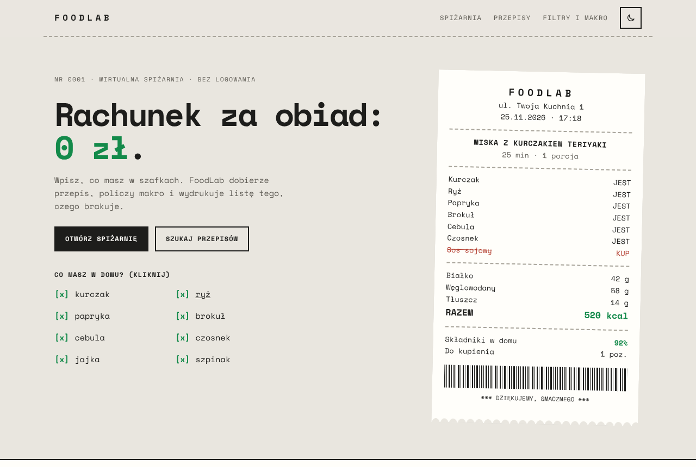
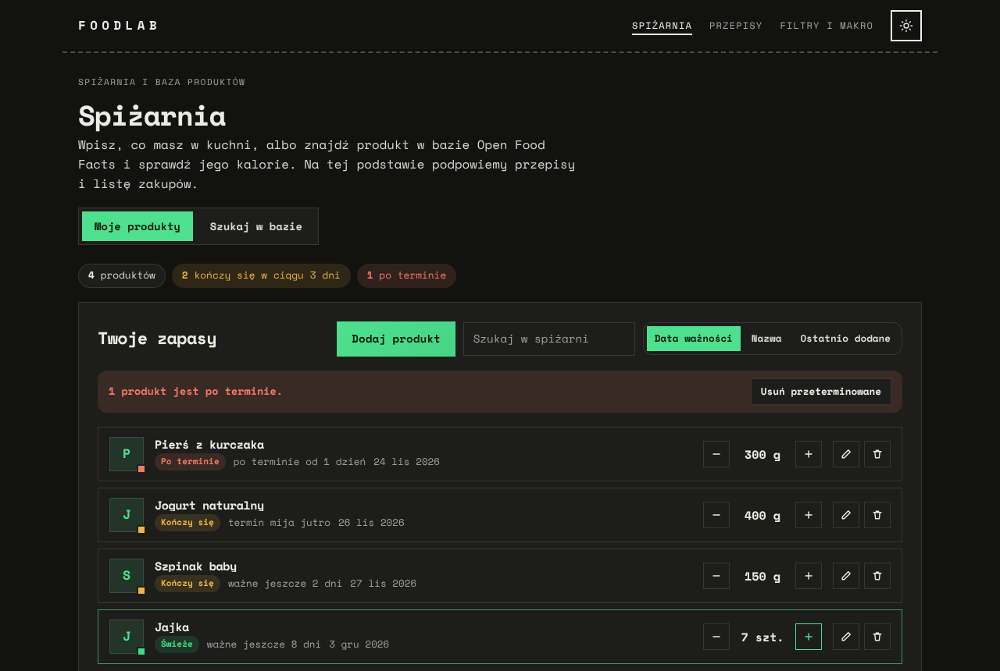
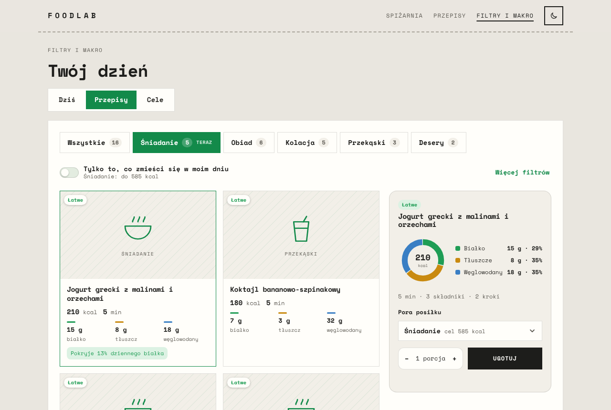
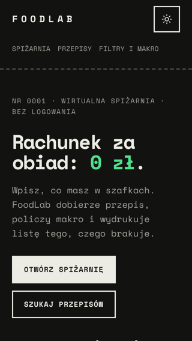

# FoodLab

Wirtualna spiżarnia, która podpowiada, co ugotować z tego, co już masz w kuchni.

FoodLab zapamiętuje produkty z Twojej kuchni razem z ilością i datą ważności, wyszukuje produkty i ich wartości odżywcze w otwartych bazach jedzenia i proponuje przepisy dopasowane do zawartości spiżarni. Brakujące składniki trafiają na listę zakupów, a przy każdym daniu widać kalorie, makroskładniki i poziom trudności. Aplikacja działa w przeglądarce, bez logowania i bez własnego backendu: wszystkie dane zostają w localStorage użytkownika.



## Zespół

| Osoba | Login | Część projektu |
|---|---|---|
| Oleksandr Tkach | @Olek2q | Wirtualna spiżarnia |
| Michał Szczygieł | @m1szczygiel | Baza produktów i integracja z Open Food Facts |
| Krzysztof Oleksy | @quazowski0 | Wyszukiwanie przepisów i lista zakupów |
| Maksymilian Zakrzewski | @Jeroklif | Filtry trudności i kalorii, podsumowanie makroskładników, wygląd aplikacji |

## Funkcjonalności

| Funkcja | Właściciel | Issue | Co robi |
|---|---|---|---|
| Wirtualna spiżarnia | @Olek2q | [#2](../../issues/2) | Dodawanie, edycja i usuwanie produktów z ilością i datą ważności. Oznaczenia „kończy się” i „po terminie”, wyszukiwanie i sortowanie. Wspólny stan (React Context), z którego korzystają pozostałe moduły. |
| Baza produktów | @m1szczygiel | [#3](../../issues/3) | Wyszukiwanie produktów w Open Food Facts i USDA, wbudowana lista produktów podstawowych (owoce, warzywa, mięso), skaner kodu kreskowego, ręczne dodawanie produktów z wartościami odżywczymi i przekazanie produktu do spiżarni. |
| Przepisy i lista zakupów | @quazowski0 | [#4](../../issues/4) | Propozycje dań ze Spoonacular posortowane według liczby brakujących składników, lista zakupów z brakami, przeliczanie porcji, tryb gotowania krok po kroku z minutnikiem, ulubione przepisy. |
| Filtry i makroskładniki | @Jeroklif | [#5](../../issues/5) | Filtry trudności (szacowanej na podstawie czasu, liczby składników i kroków) i kaloryczności, widok makroskładników przepisu, cele dzienne, podsumowanie dnia i tygodnia, filtr „z tego, co mam”. Przycisk „Ugotuj” odejmuje zużyte składniki ze spiżarni. |

Spiżarnia i baza produktów są w jednej zakładce **Spiżarnia**, w dwóch częściach: „Moje produkty” (`src/pages/Pantry.jsx`, `src/features/spizarnia`) i „Szukaj w bazie” (`src/pages/Products.jsx`, `src/features/baza`). Produkt znaleziony w bazie albo zeskanowany trafia do formularza spiżarni, gdzie ustawia się ilość i datę ważności.

## Wygląd

Interfejs jest w stylu paragonu z kasy: font maszynowy, przerywane linie i kod kreskowy. Ma tryb jasny i ciemny (przycisk w górnym pasku, wybór zapisuje się w przeglądarce) i działa na telefonach od 320 px szerokości. Na stronie startowej przepis jest wydrukowany jak paragon: zaznaczanie składników „co masz w domu” na żywo zmienia, czego brakuje i ile procent składników już masz.

| Spiżarnia (tryb ciemny) | Filtry i makro | Telefon |
|---|---|---|
|  |  |  |

## Technologia

- **Framework i język:** React, JavaScript
- **Narzędzie do budowania:** Vite
- **Routing:** React Router
- **Stan aplikacji:** React Context + useReducer
- **Zapis danych:** localStorage (bez własnego backendu)
- **API:**
  - [Open Food Facts](https://world.openfoodfacts.org/data): produkty i wartości odżywcze, bez klucza
  - [USDA FoodData Central](https://fdc.nal.usda.gov/api-guide): produkty nieprzetworzone z wartościami na 100 g, darmowy klucz `VITE_USDA_KEY` (opcjonalnie)
  - [Spoonacular](https://spoonacular.com/food-api): przepisy, wyszukiwanie po składnikach, kalorie, makro i czas przygotowania (darmowy plan)
- **Biblioteki:** html5-qrcode (skanowanie kodów kreskowych)
- **Jakość kodu:** ESLint

## Uruchomienie

```
npm install
npm run dev
```

Na Windowsie, jeśli PowerShell blokuje `npm`, użyj `npm.cmd install` i `npm.cmd run dev`.

Przepisy działają bez konfiguracji w trybie demo (przykładowe przepisy). Żeby pobierać prawdziwe przepisy ze Spoonacular, skopiuj `.env.example` jako `.env.local` i wpisz swój klucz w `VITE_SPOONACULAR_KEY` (opcjonalnie także `VITE_USDA_KEY`). Plik `.env.local` jest ignorowany przez git. Aplikacja zapisuje odpowiedzi API w localStorage i pilnuje dziennego limitu zapytań darmowego planu.

## Uwagi

- Aplikacja nie ma backendu, więc klucz Spoonacular trafia do kodu w przeglądarce i da się go podejrzeć w narzędziach deweloperskich. Do projektu na zajęcia wystarczy darmowy klucz. Nie wrzucajcie go do repozytorium i nie używajcie płatnego.
- Tytuły i składniki przepisów są tłumaczone na polski przez nieoficjalny endpoint Google Translate. Gdy przestanie działać, aplikacja pokaże tekst po angielsku.
- Wyszukiwanie w Open Food Facts idzie przez proxy Vite (`/off`), bo ich wyszukiwarka czasem odpowiada bez nagłówków CORS.
